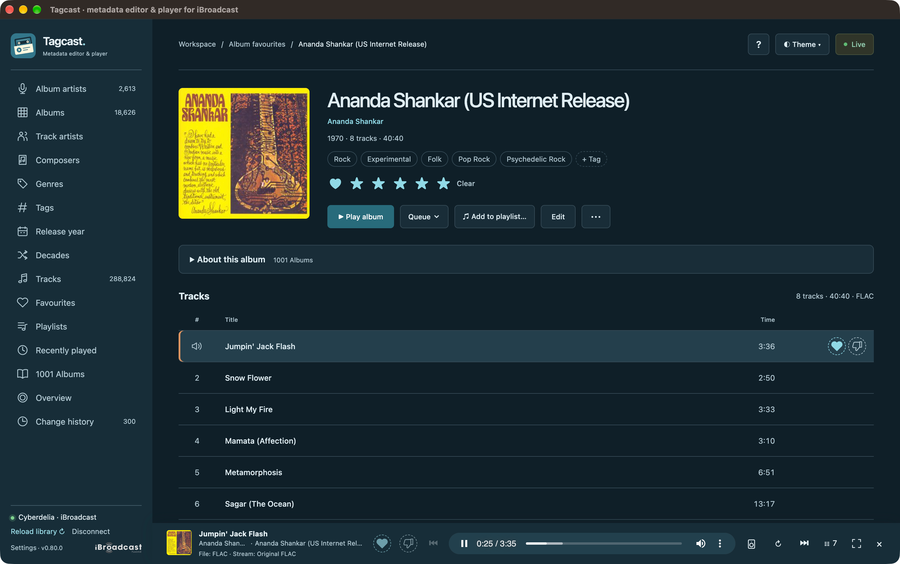
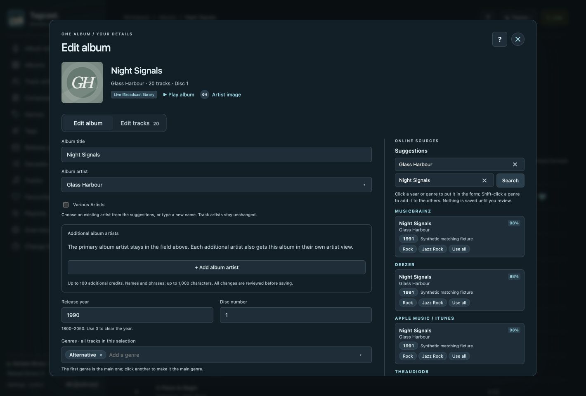
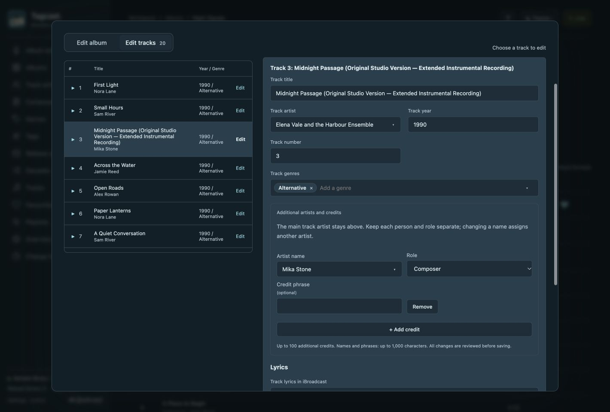
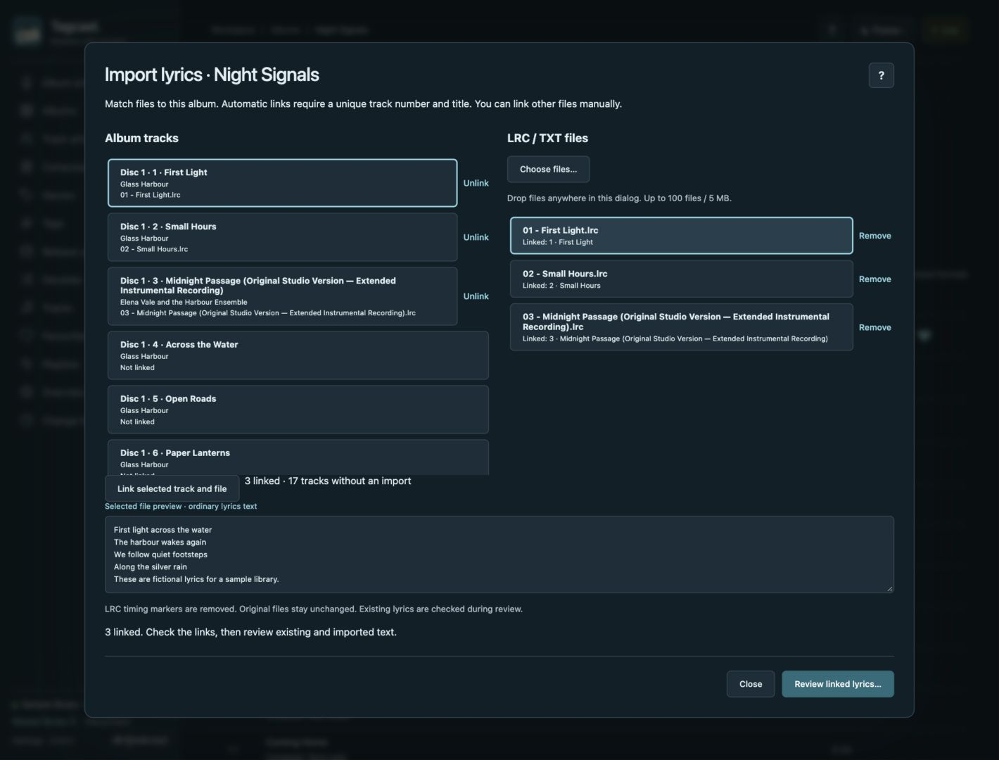
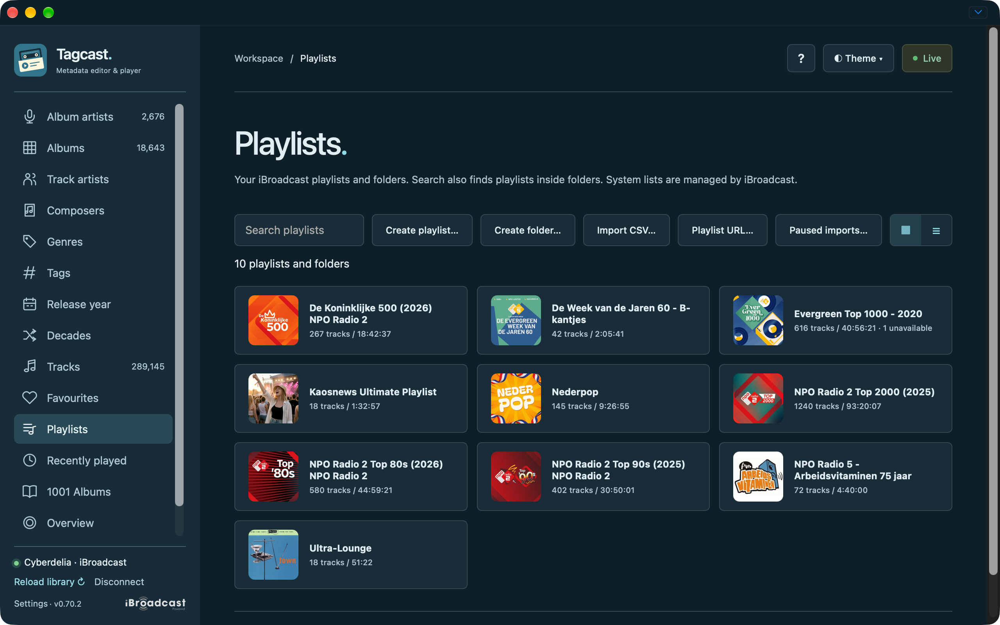
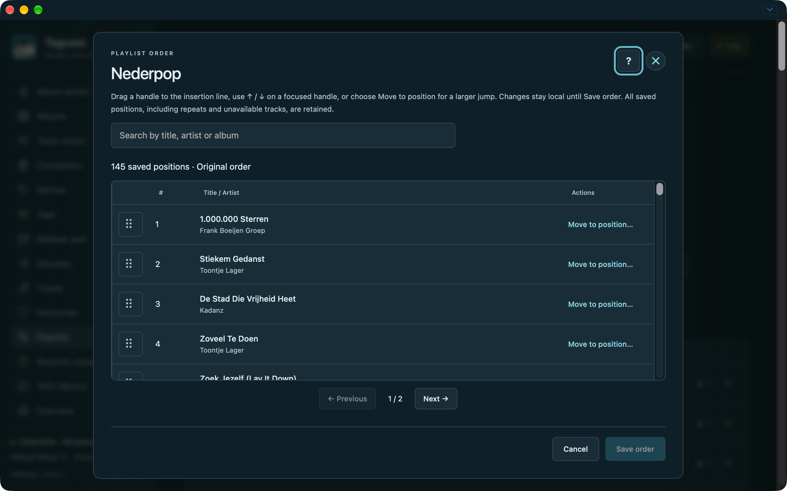
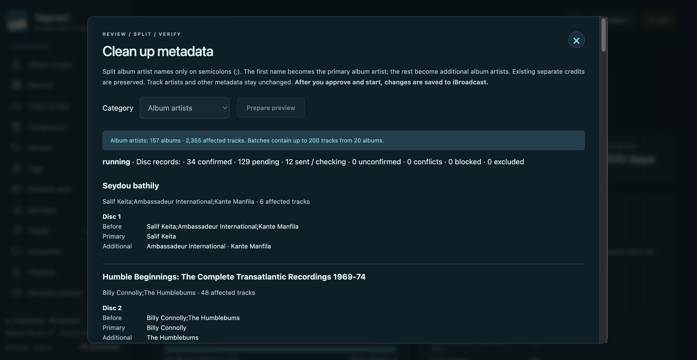

<p align="center"></p>

<h1 align="center">Tagcast</h1>
<p align="center"><b>Metadata editor &amp; player for iBroadcast.</b></p>
<p align="center"><picture><source media="(prefers-color-scheme: dark)" srcset="src/tagcast/static/ibroadcast-dark-compact-powered.svg"></picture><br><small>Independent app by Cyberdelia</small></p>
<p align="center"><a href="https://github.com/cyberdeliaAI/tagcast/actions/workflows/tests.yml"></a> <a href="LICENSE"></a></p>

Browse, discover and play your [iBroadcast](https://www.ibroadcast.com/) collection.
Fix metadata, find covers and artist images, review your changes, then save them
to iBroadcast. Use the **Electron desktop app** on macOS, Windows or Linux, or
run Tagcast in your browser with **Python**. Both share the same editor and player.

**Why Electron?**

Electron gives Tagcast a consistent desktop environment across macOS, Windows and
Linux. This helps us focus on reliable playback and safe metadata editing, while
keeping the interface shared with the browser version.

**Your local music files are never changed.** Tagcast's server listens on
`127.0.0.1` only. It is an independent project, not made or endorsed by iBroadcast.

**Latest update: [0.85.1](https://github.com/cyberdeliaAI/tagcast/releases/tag/v0.85.1)** restores the official iBroadcast service status in the standalone app.

**Introduced in [0.85.0](https://github.com/cyberdeliaAI/tagcast/releases/tag/v0.85.0):**
Optional experimental gapless playback for ordered albums, a dedicated Settings
page and official iBroadcast service health on Overview. Also tag selected albums
together, shuffle an album and browse albums in a stable random order.
[Gapless setup and limitations](docs/gapless-playback.md).

[Install](#install) · [Wiki and user guide](https://github.com/cyberdeliaAI/tagcast/wiki) · [Community](#community) · [Screenshots](#screenshots) · [Updates](#updating) · [Media kit](media/README.md)



*Tagcast 0.80.0 — album details and compact player, captured on 23 October 2026.*

## What you can do

- **Browse and discover:** artists, albums, tracks, genres, tags, years, decades
  and the optional 1001 Albums guide.
- **Listen:** album playback, a play queue, playlists, fullscreen or in-window Now playing,
  volume and available audio outputs, supported system media controls and optional
  experimental gapless playback for compatible FLAC albums in order.
- **Edit metadata:** album/track details, separate artists and credit roles, genres,
  composers and artwork, assisted
  by online sources and a before/after review.
- **Organise:** native iBroadcast tags, independent local album and artist favourites,
  native star ratings, private playlists, folders, covers, CSV and public playlist URL import.
- **Clean up:** find missing metadata, review duplicate suggestions or select
  complete albums for iBroadcast's trash. Nothing is permanently deleted.
- **Export:** full loaded-library metadata as JSON or linked CSVs in a ZIP.
- **Keep track:** read-back checks distinguish confirmed saves from uncertain
  results; Change history records metadata outcomes and available artwork Undo.

## Install

### Desktop app — no Python required

Download the archive for your computer from
[Tagcast 0.85.1](https://github.com/cyberdeliaAI/tagcast/releases/tag/v0.85.1):

| System | Download | Start |
|---|---|---|
| macOS, Apple Silicon | [ZIP](https://github.com/cyberdeliaAI/tagcast/releases/download/v0.85.1/tagcast-0.85.1-macos-arm64.zip) | Move `Tagcast.app` to Applications and open it. |
| macOS, Intel | [ZIP](https://github.com/cyberdeliaAI/tagcast/releases/download/v0.85.1/tagcast-0.85.1-macos-x64.zip) | Move `Tagcast.app` to Applications and open it. |
| Windows, x64 | [ZIP](https://github.com/cyberdeliaAI/tagcast/releases/download/v0.85.1/tagcast-0.85.1-windows-x64.zip) | Extract the whole archive, then open `Tagcast.exe`. |
| Linux, x64 | [TAR.GZ](https://github.com/cyberdeliaAI/tagcast/releases/download/v0.85.1/tagcast-0.85.1-linux-x64.tar.gz) | Extract with permissions intact; run `./Tagcast` in the `Tagcast` folder. |

macOS requires **13 Ventura or newer**. Linux needs a graphical desktop and
glibc 2.35 or newer. Keep the complete package together. No separate browser,
Python or Node.js installation is required. Each archive has a SHA-256 companion.

The apps are not Developer ID notarized or Authenticode signed. If your system
blocks opening, use **System Settings → Privacy & Security → Open Anyway** on
macOS, or **More info → Run anyway** on Windows. See the
[installation guide](https://github.com/cyberdeliaAI/tagcast/wiki/Getting-started)
for details and the bundled browser CLI.

### Homebrew on macOS

```sh
brew install --cask cyberdeliaAI/apps/tagcast
```

Homebrew installs the matching desktop app and links `tagcast-cli` for terminal use.
[Homebrew guide](https://github.com/cyberdeliaAI/homebrew-apps#readme).

### Python/browser version

Extract the release's **Source code** archive or clone this repository. With
**Python 3.11+** or **uv**, use the script for your computer:

| macOS | Windows | Linux |
|---|---|---|
| `start-tagcast.command` | `start-tagcast.bat` | `./start-tagcast.sh` |

The scripts prepare a local environment and open your browser. Keep the terminal
open; Ctrl+C stops its server. From the source folder, uv users can also run:

```sh
uv run --frozen tagcast --open
```

[Source setup and port options](https://github.com/cyberdeliaAI/tagcast/wiki/Getting-started#run-from-source-with-python-or-uv).
No Node.js or Tk is required for normal Python/browser use.

## Connect iBroadcast

Choose **Connect iBroadcast → Sign in with a code**, approve Tagcast on the
iBroadcast website, then return. No client ID setup or client secret is needed;
your password stays on iBroadcast. Without an account, a demo library lets you
preview browsing and edits without saving to iBroadcast.

Settings, tokens, cache and local album favourites stay in `~/.tagcast/`, or
`TAGCAST_HOME`. Electron has its own Chromium profile; browser-local preferences,
Change history and queues are separate from your other browsers.
[Connection guide](https://github.com/cyberdeliaAI/tagcast/wiki/Connecting-to-iBroadcast).

## User guide

The **[Wiki](https://github.com/cyberdeliaAI/tagcast/wiki)** contains the full guide,
organised into focused pages:

| Topic | Guide |
|---|---|
| Install, connect and update | [Getting started](https://github.com/cyberdeliaAI/tagcast/wiki/Getting-started) · [Sign-in](https://github.com/cyberdeliaAI/tagcast/wiki/Connecting-to-iBroadcast) |
| Artists, albums, filters and appearance | [Browsing and discovery](https://github.com/cyberdeliaAI/tagcast/wiki/Browsing-and-discovery) |
| Sound, Now playing, queues and remote control | [Playback and queue](https://github.com/cyberdeliaAI/tagcast/wiki/Playback-and-queue) |
| Stars and hearts | [Ratings and favourites](https://github.com/cyberdeliaAI/tagcast/wiki/Ratings-and-favourites) |
| Playlists, folders and imports | [Playlists](https://github.com/cyberdeliaAI/tagcast/wiki/Playlists) · [CSV import](https://github.com/cyberdeliaAI/tagcast/wiki/Importing-playlists) · [Public playlist URLs](https://github.com/cyberdeliaAI/tagcast/wiki/Importing-public-playlists) |
| Native iBroadcast labels | [Tags](https://github.com/cyberdeliaAI/tagcast/wiki/Tags) |
| Editing metadata and compilation albums | [Metadata editor](https://github.com/cyberdeliaAI/tagcast/wiki/Editing-metadata) · [Various Artists walkthrough](https://github.com/cyberdeliaAI/tagcast/wiki/Various-Artists) · [Artist credits](https://github.com/cyberdeliaAI/tagcast/wiki/Artists-and-credits) |
| Suggestions, images and lyrics | [Online sources](https://github.com/cyberdeliaAI/tagcast/wiki/Online-sources) · [Artwork](https://github.com/cyberdeliaAI/tagcast/wiki/Artwork-and-artist-images) · [Lyrics](https://github.com/cyberdeliaAI/tagcast/wiki/Lyrics) · [LRC/TXT import](https://github.com/cyberdeliaAI/tagcast/wiki/Importing-lyrics) |
| Reviewed cleanup and trash | [Cleanup and duplicates](https://github.com/cyberdeliaAI/tagcast/wiki/Cleanup-and-duplicates) |
| Listening-list matches and background texts | [1001 Albums](https://github.com/cyberdeliaAI/tagcast/wiki/1001-Albums) |
| Settings, Help, saves, multi-disc sets and large libraries | [Settings and help](https://github.com/cyberdeliaAI/tagcast/wiki/Settings-and-help) · [Saving and history](https://github.com/cyberdeliaAI/tagcast/wiki/Saving-and-history) |

## Screenshots

The [full gallery](https://github.com/cyberdeliaAI/tagcast/wiki/Screenshots) shows
browsing, tags, editing, cleanup, playback, Settings and mobile views. The latest
captures show 0.80.0 with a separate sample library, including the
metadata editor, narrow-window player and lyrics import. Earlier-interface examples
stay labelled. The [capture inventory](docs/screenshot-checklist.md) records the originals.

<details>
<summary>Current editor and lyrics import, playlists and retained cleanup/fullscreen examples</summary>











**Album artist cleanup:** reviewed semicolon splitting into a primary
artist and separate additional artists. This capture shows an approved run in progress.




</details>

## Updating

**Quit the older Tagcast first**, or stop its terminal server with Ctrl+C. Replace
it with the new download, or update your source checkout. Your server settings
and local account favourites remain in place. Electron rejects an older server
on its port rather than loading the old interface.

For Homebrew: `brew update`, then `brew upgrade --cask cyberdeliaAI/apps/tagcast`.
Tagcast's update check only notifies; it never installs updates automatically.
[Update instructions](https://github.com/cyberdeliaAI/tagcast/wiki/Getting-started#updating-tagcast).

## Community

Join **[r/Tagcast on Reddit](https://www.reddit.com/r/Tagcast/)** to ask questions,
share ideas and discuss Tagcast with other listeners. For bug reports, use
[GitHub Issues](https://github.com/cyberdeliaAI/tagcast/issues).

## Development

A Python server and plain JavaScript frontend are shared by both routes.
[Development and API notes](https://github.com/cyberdeliaAI/tagcast/wiki/Development),
[Electron design](docs/electron.md) and [native builds](docs/native-builds.md)
describe the architecture, test commands and packaging. See
[documentation maintenance](docs/documentation.md) for Wiki updates.

## Media, credits and license

The [media kit](media/README.md) contains logos, icons, wordmarks, screenshots and
the GitHub social preview. [Download the media ZIP](https://github.com/cyberdeliaAI/tagcast/raw/refs/heads/main/media/tagcast-media-kit.zip).

Developed by Cyberdelia, with AI-assisted development using Claude (Anthropic)
and ChatGPT / Codex (OpenAI).

[MIT](LICENSE) for Tagcast code. The original Powered by iBroadcast logos belong
to iBroadcast and are displayed under its
[branding guidelines](https://help.ibroadcast.com/en/developer/branding).
