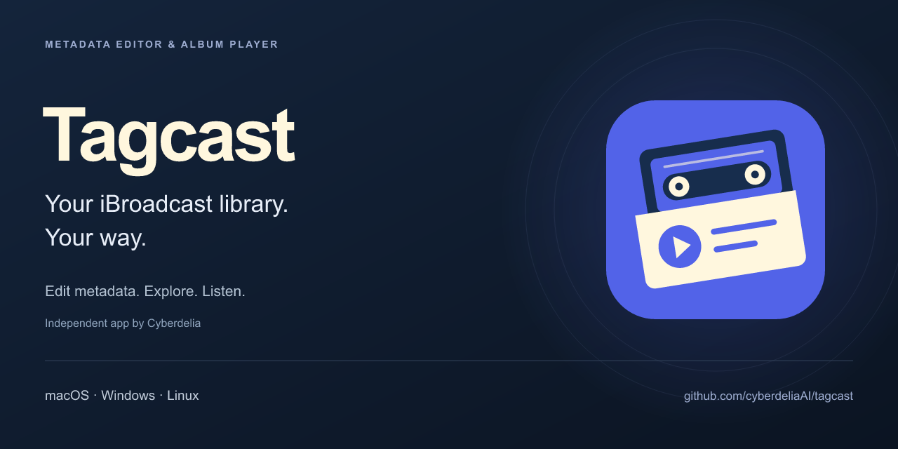
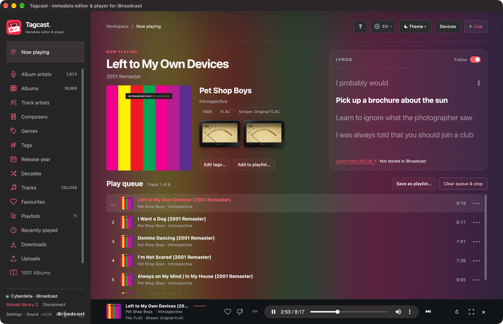
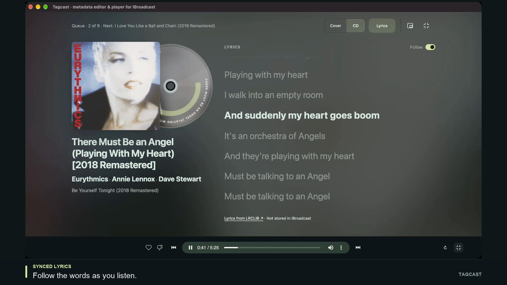

<p align="center"></p>

<p align="center"><b>Metadata editor &amp; player for iBroadcast.</b></p>
<p align="center"><picture><source media="(prefers-color-scheme: dark)" srcset="src/tagcast/static/ibroadcast-dark-compact-powered.svg"></picture><br><small>Independent app by Cyberdelia</small></p>
<p align="center"><a href="https://github.com/cyberdeliaAI/tagcast/actions/workflows/tests.yml"></a> <a href="LICENSE"></a></p>

Tagcast is an app for browsing, playing and organising your
[iBroadcast](https://www.ibroadcast.com/) music library. Fix metadata, find covers
and artist images, review every change, then save it to your iBroadcast account.
Use the desktop app on macOS, Windows or Linux, or run Tagcast in your browser with
Python. Both share the same editor and player.

Tagcast is an **independent application for iBroadcast**. It is not made or endorsed
by iBroadcast. Metadata editing changes your iBroadcast library, never the music
files on your computer.

[Download](#download-and-install) · [User guide](https://github.com/cyberdeliaAI/tagcast/wiki) · [Walkthrough video](https://tagcast.app/#walkthrough) · [Website](https://tagcast.app/) · [Community](#documentation-and-support) · [Media kit](media/README.md)

<a id="install"></a>

## Download and install

### Desktop app — no Python required

Download the archive for your computer from
[Tagcast 1.8.0](https://github.com/cyberdeliaAI/tagcast/releases/tag/v1.8.0)
([release notes](.github/release-notes/1.8.0.md)):

| System | Download | Start |
|---|---|---|
| macOS, Apple Silicon | [ZIP](https://github.com/cyberdeliaAI/tagcast/releases/download/v1.8.0/tagcast-1.8.0-macos-arm64.zip) | Move `Tagcast.app` to Applications and open it. |
| macOS, Intel | [ZIP](https://github.com/cyberdeliaAI/tagcast/releases/download/v1.8.0/tagcast-1.8.0-macos-x64.zip) | Move `Tagcast.app` to Applications and open it. |
| Windows, x64 | [ZIP](https://github.com/cyberdeliaAI/tagcast/releases/download/v1.8.0/tagcast-1.8.0-windows-x64.zip) | Extract the whole archive, then open `Tagcast.exe`. |
| Linux, x64 | [TAR.GZ](https://github.com/cyberdeliaAI/tagcast/releases/download/v1.8.0/tagcast-1.8.0-linux-x64.tar.gz) | Extract with permissions intact; run `./Tagcast` in the `Tagcast` folder. |
| Debian / Ubuntu, x64 | [DEB](https://github.com/cyberdeliaAI/tagcast/releases/download/v1.8.0/tagcast-1.8.0-linux-amd64.deb) | Install with `sudo apt install ./tagcast-1.8.0-linux-amd64.deb`; open Tagcast from the app menu. |

macOS needs **13 Ventura or newer**. Linux needs a graphical desktop and glibc 2.35
or newer. Keep the complete package together. Each archive has a SHA-256 companion
file. The macOS downloads are **Developer ID signed and notarized by Apple**. Windows
downloads are **not yet signed**, so Windows may show **More info → Run anyway**
after you check the download. See the [code signing policy](#code-signing-policy),
the [installation guide](https://github.com/cyberdeliaAI/tagcast/wiki/Getting-started)
and the [privacy policy](PRIVACY.md).

### Homebrew on macOS

```sh
brew install --cask cyberdeliaAI/apps/tagcast
```

This installs the matching desktop app and links `tagcast-cli` for terminal use.
See the [Homebrew guide](https://github.com/cyberdeliaAI/homebrew-apps#readme).

<details>
<summary>Run in your browser with Python instead</summary>

Extract the release's **Source code** archive or clone this repository. With
**Python 3.11+** or **uv**, start the script for your computer:
`start-tagcast.command` (macOS), `start-tagcast.bat` (Windows) or
`./start-tagcast.sh` (Linux). It prepares a local environment and opens your
browser. Keep its terminal open; Ctrl+C stops the server. With uv you can also run
`uv run --frozen tagcast --open` from the source folder. No Node.js or Tk is needed.
See [Python and browser version](https://github.com/cyberdeliaAI/tagcast/wiki/Python-and-browser-version)
for port options and the differences from the desktop app.

</details>

<a id="updating"></a>

### Updating

Quit the old Tagcast, then replace it with the new download (Homebrew:
`brew update`, then `brew upgrade --cask cyberdeliaAI/apps/tagcast`). Your settings
stay in place. Tagcast notifies you about new releases but never installs them.
See [Updating Tagcast](https://github.com/cyberdeliaAI/tagcast/wiki/Getting-started#updating-tagcast).

### Your iBroadcast account

Choose **Connect iBroadcast → Sign in with iBroadcast** and approve Tagcast in the
iBroadcast window. Your password stays on iBroadcast. Without an account, a demo
library lets you try browsing and edit previews; nothing is saved. See
[Connecting to iBroadcast](https://github.com/cyberdeliaAI/tagcast/wiki/Connecting-to-iBroadcast).

iBroadcast decides storage, bandwidth, which tracks are available and which
features need Premium. Tagcast does not provide storage or remove those limits;
music hidden by a limit has not necessarily been deleted (see
[iBroadcast's plan changes](https://news.ibroadcast.com/pricing-update)).
Original-quality streaming and saving lyrics need Premium. Free accounts stream at
MP3 128 kbps.

## What you can do

- **Browse and discover.** Artists, albums, tracks, genres, tags, years and decades,
  plus an optional 1001 Albums listening guide.
- **Listen.** Albums, a play queue, playlists and a full Now playing view with
  optional synchronised lyrics. [Gapless playback](https://github.com/cyberdeliaAI/tagcast/wiki/Gapless-playback)
  for compatible FLAC albums is experimental, optional and off by default.
- **Edit metadata with review.** Album and track details, artists and credits,
  genres, composers and artwork, with online suggestions and a before/after review.
  Tagcast checks saves against iBroadcast afterwards.
- **Organise.** Native tags, favourites, star ratings, playlists and folders, with
  CSV and public playlist import.
- **Clean up.** Find missing metadata, review duplicate suggestions, merge or split
  albums, or move chosen tracks to iBroadcast's trash. Nothing is permanently deleted.
- **Download and upload (optional).** [Album downloads](https://github.com/cyberdeliaAI/tagcast/wiki/Downloads)
  create separate, reviewed local copies. [Music uploads](https://github.com/cyberdeliaAI/tagcast/wiki/Music-uploads)
  send selected local files to your own library after review and are off by default.
- **Make it yours.** Six interface languages, built-in and custom colour themes.
- **Export.** Library metadata as JSON or CSV files.

## See Tagcast in action



*Now playing in Tagcast 1.7.0, captured on 11 November 2026. More screenshots are in
the [Wiki gallery](https://github.com/cyberdeliaAI/tagcast/wiki/Screenshots).*

<a id="screenshots"></a>

[](https://tagcast.app/#walkthrough)

**[Watch the walkthrough](https://tagcast.app/#walkthrough)** (2 minutes 42 seconds,
short English captions, no sound): playback, lyrics, themes, browsing, cleanup,
album downloads and playlist import.

<a id="community"></a>

## Documentation and support

The **[Tagcast Wiki](https://github.com/cyberdeliaAI/tagcast/wiki)** is the full user
guide. Good places to start:

- [Getting started](https://github.com/cyberdeliaAI/tagcast/wiki/Getting-started): install, connect and first use
- [Editing metadata](https://github.com/cyberdeliaAI/tagcast/wiki/Editing-metadata) and [what is saved where](https://github.com/cyberdeliaAI/tagcast/wiki/Whats-saved-where)
- [Playback and queue](https://github.com/cyberdeliaAI/tagcast/wiki/Playback-and-queue)
- [Troubleshooting](https://github.com/cyberdeliaAI/tagcast/wiki/Troubleshooting)
- [Illustrated PDF manual](https://github.com/cyberdeliaAI/tagcast/wiki/PDF-manual) for offline reading (English, describes 1.7.0)

Ask questions and share ideas on [r/Tagcast](https://www.reddit.com/r/Tagcast/).
Report bugs through [GitHub Issues](https://github.com/cyberdeliaAI/tagcast/issues).
Do not include tokens, source keys or private library exports.

## Privacy, security and development

**Privacy.** Tagcast's server listens on `127.0.0.1` only and sends no analytics.
Settings and sign-in data stay on your computer, normally in `~/.tagcast/`. Update
checks and online lookups contact public services; the
[privacy policy](PRIVACY.md) lists what each one sends and how to turn it off.

**Security.** Metadata, playlist, tag and trash changes show a review first, and
saves are checked against iBroadcast afterwards. Downloads and uploads start only
when you choose Start. See [Privacy and security](https://github.com/cyberdeliaAI/tagcast/wiki/Privacy-and-security)
in the Wiki.

**Development.** A Python server and a plain JavaScript frontend are shared by the
desktop app and the browser version. See the
[development notes](https://github.com/cyberdeliaAI/tagcast/wiki/Development),
[Electron design](docs/electron.md), [native builds](docs/native-builds.md) and
[documentation maintenance](docs/documentation.md).

## Code signing policy

The macOS downloads are Developer ID signed and notarized by Apple. Windows
downloads are **not yet signed**. Tagcast has applied for Windows code signing
through SignPath; approval and integration are pending.

The planned signing service, subject to approval and integration, is: free code
signing provided by [SignPath.io](https://signpath.io/), certificate by
[SignPath Foundation](https://signpath.org/).

- **Committers and reviewers:** [kaosnews](https://github.com/kaosnews).
- **Approvers:** [kaosnews](https://github.com/kaosnews).
- People with source-code or signing approval access are required to use MFA on
  GitHub and SignPath. This policy does not certify individual account settings.
- Once enabled, release signing requests must be manually approved by the
  designated approver. Only verified builds from this repository will be submitted,
  and release notes will say which downloads are signed.

See the [privacy policy](PRIVACY.md) for iBroadcast connections, optional lookups,
automatic update checks and the public service-status feed.

## Credits and license

Developed by Cyberdelia, with AI-assisted development using Claude (Anthropic),
ChatGPT / Codex (OpenAI) and Mistral (Mistral AI). Logos, icons and screenshots are
in the [media kit](media/README.md) ([ZIP download](https://github.com/cyberdeliaAI/tagcast/raw/refs/heads/main/media/tagcast-media-kit.zip)).

[MIT](LICENSE) for Tagcast code. The original Powered by iBroadcast logos belong to
iBroadcast and are displayed under its
[branding guidelines](https://help.ibroadcast.com/en/developer/branding).
