<p align="center"></p>

<h1 align="center">Tagcast</h1>
<p align="center"><b>Metadata editor &amp; player for iBroadcast.</b></p>
<p align="center"><picture><source media="(prefers-color-scheme: dark)" srcset="src/tagcast/static/ibroadcast-dark-compact-powered.svg"></picture><br><small>Independent app by Cyberdelia</small></p>
<p align="center"><a href="https://github.com/cyberdeliaAI/tagcast/actions/workflows/tests.yml"></a> <a href="LICENSE"></a></p>

Browse, discover and play your [iBroadcast](https://www.ibroadcast.com/) collection.
Fix metadata, find covers and artist images, review your changes, then save them
to iBroadcast. Use the **Electron desktop app** on macOS, Windows or Linux, or
run Tagcast in your browser with **Python**. Both share the same editor and player.

**Why Electron?**

Electron gives Tagcast a consistent desktop environment across macOS, Windows and
Linux. This helps us focus on reliable playback and safe metadata editing, while
keeping the interface shared with the browser version.

**Your existing local music files are never changed.** Optional album downloads
create separate local copies. Optional music uploads read selected local audio and
send copies to your own iBroadcast library only after review; see
[setup, privacy and current validation limits](docs/music-uploads.md). Tagcast's server listens on `127.0.0.1` only. It is an independent project, not made or endorsed by iBroadcast.

**New in [Tagcast 1.5.5](https://github.com/cyberdeliaAI/tagcast/releases/tag/v1.5.5):**
A redesigned Now playing workspace brings artwork, track details, optional retro
stereo meters, a focused lyrics panel and the queue together. Fullscreen offers
Cover or rotating CD views, with or without lyrics. Search controls stay reachable,
pagination returns to the listing controls, and sorting and the local queue are
remembered across restarts without starting playback automatically. Amber joins
the built-in palettes; all six interface languages remain available.
This update also fixes header menus behind search controls, intermittent playing
indicators and partial queue-row hover highlights from the withdrawn 1.5.0 release.

Experimental Gapless playback remains optional and off by default. Unsupported
transitions safely use ordinary playback. See the
[release notes](.github/release-notes/1.5.5.md) and
[Gapless setup and limitations](docs/gapless-playback.md).

[Website](https://tagcast.app/) · [Install](#install) · [Wiki and user guide](https://github.com/cyberdeliaAI/tagcast/wiki) · [Community](#community) · [Screenshots](#screenshots) · [Updates](#updating) · [Media kit](media/README.md)

**Offline guide:** [Download the illustrated Tagcast 1.4.0 manual (PDF)](https://raw.githubusercontent.com/wiki/cyberdeliaAI/tagcast/manuals/Tagcast-1.4.0-User-Manual.pdf) — English, 38 pages, with screenshots and clickable contents.

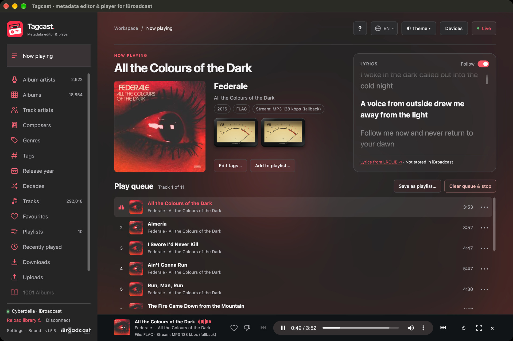

*Tagcast 1.5.5 — the Now playing workspace, captured on 6 November 2026. [See fullscreen and album views below](#screenshots).*

## What you can do

iBroadcast controls account limits, available tracks and Premium entitlements.
Tagcast does not provide storage, remove provider limits or replace every iBroadcast
feature. See [iBroadcast's announced plan changes](https://news.ibroadcast.com/an-important-update-on-ibroadcast-s-pricing)
for storage and bandwidth rules; music hidden by those limits has not necessarily
been deleted. Original-quality streaming and lyrics saving require the corresponding
iBroadcast Premium access.

- **Browse and discover:** artists, albums, tracks, genres, tags, years, decades
  and the optional 1001 Albums guide.
- **Listen:** album playback, a play queue, playlists, fullscreen or in-window Now playing,
  volume and available audio outputs, supported system media controls and optional
  experimental gapless playback for compatible FLAC albums in order.
- **Edit metadata:** album/track details, separate artists and credit roles, genres,
  composers and artwork, assisted
  by online sources and a before/after review.
- **Organise:** native iBroadcast tags, independent local album and artist favourites,
  native star ratings, private playlists, folders, covers, CSV and public playlist URL import.
- **Clean up:** find missing metadata, review duplicate suggestions or select
  complete albums for iBroadcast's trash. Nothing is permanently deleted.
- **Download albums:** reviewed local audio copies using the existing account connection,
  with quality choices, resumable streaming transfers and existing-file protection.
- **Upload music:** optional, reviewed uploads of selected local files or folders,
  with identical-file checks and explicit Start, Pause and Stop controls.
- **Lyrics:** follow temporary online text in expanded Now playing, or explicitly find
  ordinary LRCLIB text in the editor and review it before saving. See [lyrics sources
  and privacy](docs/now-playing-lyrics.md).
- **Personalise:** choose from six built-in palettes, create custom Light/Dark colour themes, preview changes and share
  themes through JSON import/export.
- **Export:** full loaded-library metadata as JSON or linked CSVs in a ZIP.
- **Keep track:** read-back checks distinguish confirmed saves from uncertain
  results; Change history records metadata outcomes and available artwork Undo.

[Album downloads](docs/audio-downloads.md) use
[ibfetch](https://github.com/cyberdeliaAI/ibfetch)'s transfer engine. For individual
tracks, playlists and advanced command-line download options, use ibfetch.

**Upcoming, not yet released:** [Manually split an album](docs/album-splitting.md),
with reviewed track selection and an illustrated real-library example. The current
1.5.5 downloads do not include this action.

## Install

### Desktop app — no Python required

Download the archive for your computer from
[Tagcast 1.5.5](https://github.com/cyberdeliaAI/tagcast/releases/tag/v1.5.5):

| System | Download | Start |
|---|---|---|
| macOS, Apple Silicon | [ZIP](https://github.com/cyberdeliaAI/tagcast/releases/download/v1.5.5/tagcast-1.5.5-macos-arm64.zip) | Move `Tagcast.app` to Applications and open it. |
| macOS, Intel | [ZIP](https://github.com/cyberdeliaAI/tagcast/releases/download/v1.5.5/tagcast-1.5.5-macos-x64.zip) | Move `Tagcast.app` to Applications and open it. |
| Windows, x64 | [ZIP](https://github.com/cyberdeliaAI/tagcast/releases/download/v1.5.5/tagcast-1.5.5-windows-x64.zip) | Extract the whole archive, then open `Tagcast.exe`. |
| Linux, x64 | [TAR.GZ](https://github.com/cyberdeliaAI/tagcast/releases/download/v1.5.5/tagcast-1.5.5-linux-x64.tar.gz) | Extract with permissions intact; run `./Tagcast` in the `Tagcast` folder. |

macOS requires **13 Ventura or newer**. Linux needs a graphical desktop and
glibc 2.35 or newer. Keep the complete package together. No separate browser,
Python or Node.js installation is required. Each archive has a SHA-256 companion.

**[Code signing policy](#code-signing-policy)** · **[Privacy policy](PRIVACY.md)**

The macOS downloads are **Developer ID signed and notarized by Apple**. Windows
downloads are not yet Authenticode signed; Windows may show **More info → Run anyway**
after you review the download. See the
[installation guide](https://github.com/cyberdeliaAI/tagcast/wiki/Getting-started)
for details and the bundled browser CLI.

### Homebrew on macOS

```sh
brew install --cask cyberdeliaAI/apps/tagcast
```

Homebrew installs the matching desktop app and links `tagcast-cli` for terminal use.
[Homebrew guide](https://github.com/cyberdeliaAI/homebrew-apps#readme).

### Python/browser version

Extract the release's **Source code** archive or clone this repository. With
**Python 3.11+** or **uv**, use the script for your computer:

| macOS | Windows | Linux |
|---|---|---|
| `start-tagcast.command` | `start-tagcast.bat` | `./start-tagcast.sh` |

The scripts prepare a local environment and open your browser. Keep the terminal
open; Ctrl+C stops its server. From the source folder, uv users can also run:

```sh
uv run --frozen tagcast --open
```

[Source setup and port options](https://github.com/cyberdeliaAI/tagcast/wiki/Getting-started#run-from-source-with-python-or-uv).
No Node.js or Tk is required for normal Python/browser use.

## Connect iBroadcast

Choose **Connect iBroadcast → Sign in with iBroadcast** and approve Tagcast in the
iBroadcast sign-in window. Tagcast returns automatically; a code and browser link
remain available as a fallback. No client ID setup or client secret is needed;
your password stays on iBroadcast. Without an account, a demo library lets you
preview browsing and edits without saving to iBroadcast.

Settings, tokens, cache and local album favourites stay in `~/.tagcast/`, or
`TAGCAST_HOME`. Electron has its own Chromium profile; browser-local preferences,
Change history and queues are separate from your other browsers.
[Connection guide](https://github.com/cyberdeliaAI/tagcast/wiki/Connecting-to-iBroadcast).

## User guide

The **[Wiki](https://github.com/cyberdeliaAI/tagcast/wiki)** contains the full guide,
organised into focused pages:

| Topic | Guide |
|---|---|
| Install, connect and update | [Getting started](https://github.com/cyberdeliaAI/tagcast/wiki/Getting-started) · [Sign-in](https://github.com/cyberdeliaAI/tagcast/wiki/Connecting-to-iBroadcast) |
| Artists, albums, filters and appearance | [Browsing and discovery](https://github.com/cyberdeliaAI/tagcast/wiki/Browsing-and-discovery) |
| Sound, Now playing, queues and remote control | [Playback and queue](https://github.com/cyberdeliaAI/tagcast/wiki/Playback-and-queue) |
| Stars and hearts | [Ratings and favourites](https://github.com/cyberdeliaAI/tagcast/wiki/Ratings-and-favourites) |
| Playlists, folders and imports | [Playlists](https://github.com/cyberdeliaAI/tagcast/wiki/Playlists) · [CSV import](https://github.com/cyberdeliaAI/tagcast/wiki/Importing-playlists) · [Public playlist URLs](https://github.com/cyberdeliaAI/tagcast/wiki/Importing-public-playlists) |
| Native iBroadcast labels | [Tags](https://github.com/cyberdeliaAI/tagcast/wiki/Tags) |
| Editing metadata and compilation albums | [Metadata editor](https://github.com/cyberdeliaAI/tagcast/wiki/Editing-metadata) · [Various Artists walkthrough](https://github.com/cyberdeliaAI/tagcast/wiki/Various-Artists) · [Artist credits](https://github.com/cyberdeliaAI/tagcast/wiki/Artists-and-credits) |
| Suggestions, images and lyrics | [Online sources](https://github.com/cyberdeliaAI/tagcast/wiki/Online-sources) · [Artwork](https://github.com/cyberdeliaAI/tagcast/wiki/Artwork-and-artist-images) · [Lyrics](https://github.com/cyberdeliaAI/tagcast/wiki/Lyrics) · [LRC/TXT import](https://github.com/cyberdeliaAI/tagcast/wiki/Importing-lyrics) |
| Reviewed cleanup and trash | [Cleanup and duplicates](https://github.com/cyberdeliaAI/tagcast/wiki/Cleanup-and-duplicates) |
| Listening-list matches and background texts | [1001 Albums](https://github.com/cyberdeliaAI/tagcast/wiki/1001-Albums) |
| Settings, Help, saves, multi-disc sets and large libraries | [Settings and help](https://github.com/cyberdeliaAI/tagcast/wiki/Settings-and-help) · [Saving and history](https://github.com/cyberdeliaAI/tagcast/wiki/Saving-and-history) |

## Screenshots

The latest captures show **Tagcast 1.5.5** on macOS. The Now playing workspace
appears above; expand the gallery below for fullscreen CD and cover views with
lyrics, and the album page. Online lyrics are displayed temporarily and are not
saved automatically to iBroadcast.

<details>
<summary>Tagcast 1.5.5 — fullscreen lyrics, CD view and album details</summary>

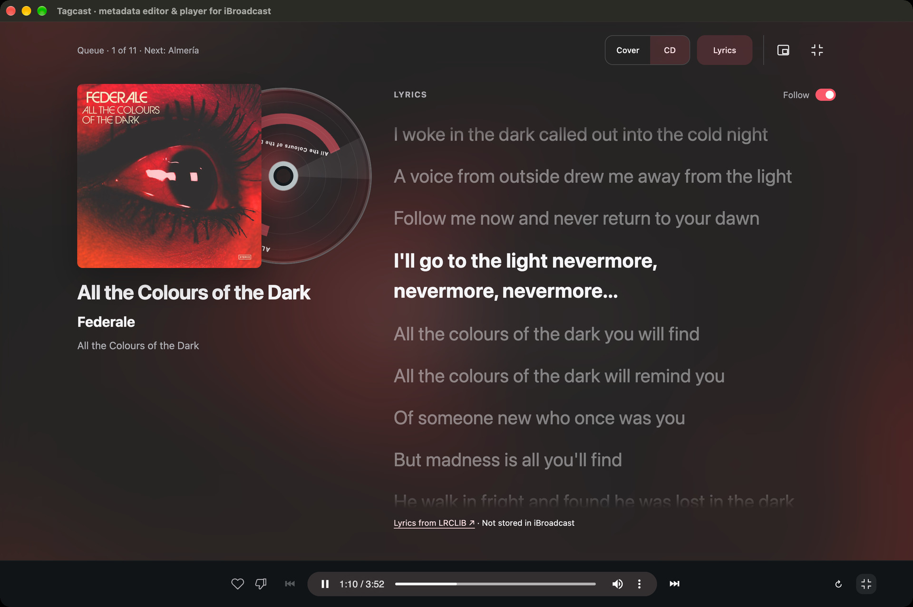

*CD view keeps the cover upright while the disc rotates during playback.*

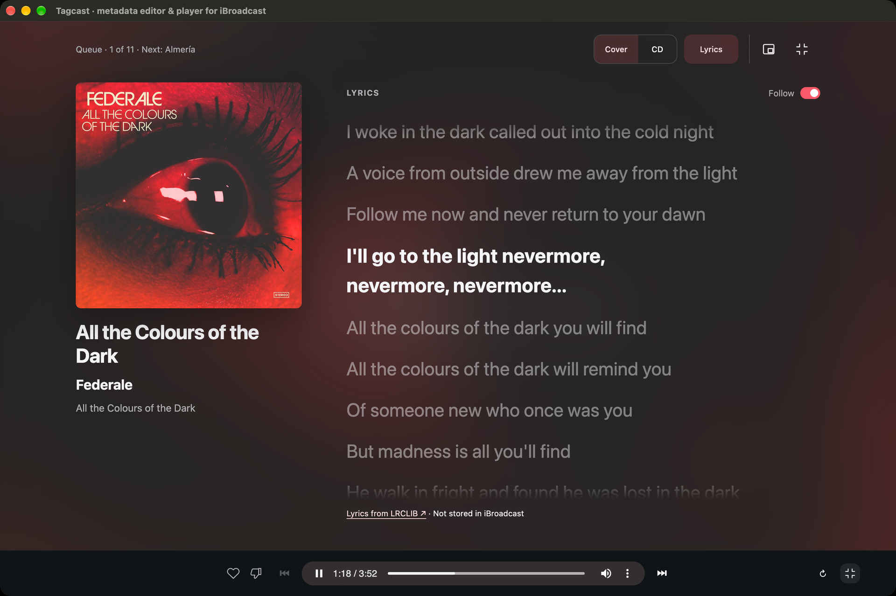

*Cover view with lyrics following the current track against a cover-coloured background.*

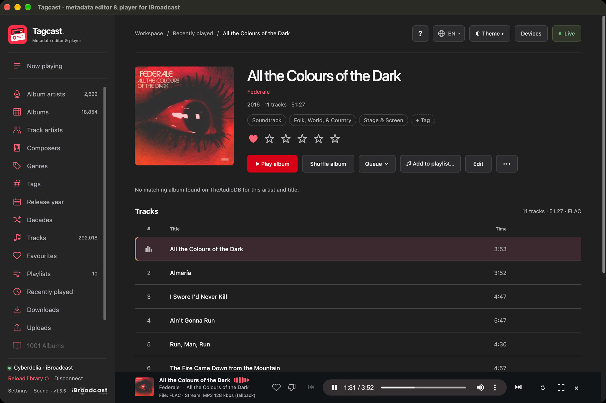

*Album details and the compact player in the Apple Music Classic Dark palette.*

</details>

The [full Wiki gallery](https://github.com/cyberdeliaAI/tagcast/wiki/Screenshots)
also covers browsing, tags, editing, cleanup, Settings and mobile views.
[This batch's capture notes](docs/screenshots/2026-11-06-1.5.5/README.md) and the
[earlier capture inventory](docs/screenshot-checklist.md) record the originals.

<details>
<summary>Earlier interface examples — Tagcast 1.3.0, editor, lyrics import, playlists and cleanup</summary>

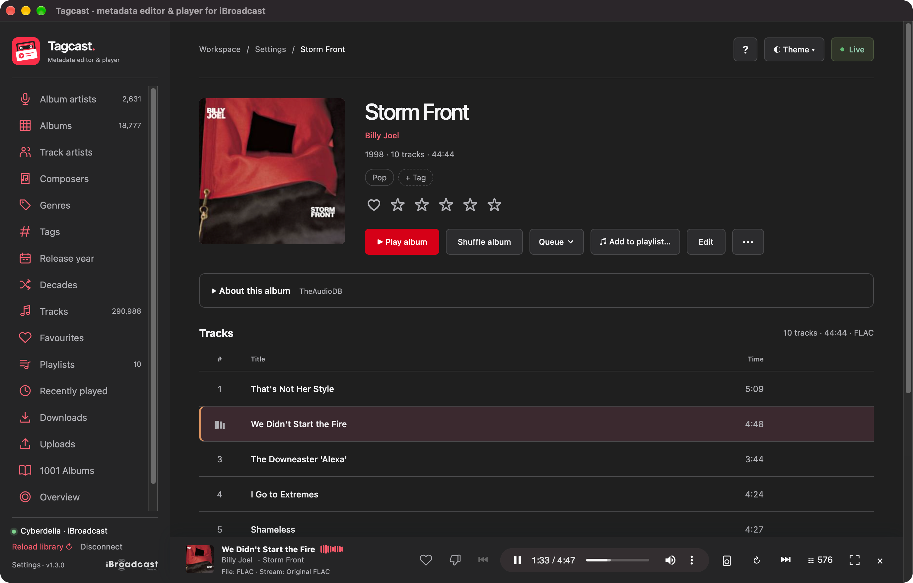

*Tagcast 1.3.0 — album details and playback in the Apple Music Classic Dark palette, captured on 2 November 2026.*

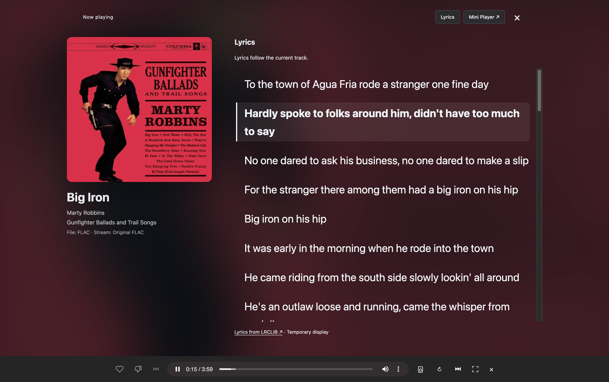

*Tagcast 1.3.0 — lyrics follow the current track in Now playing, against an optional cover-coloured background. Online lyrics are displayed temporarily.*

*The following editor and lyrics-import examples show 0.80.0 with a separate sample library; other retained captures show earlier interface versions.*

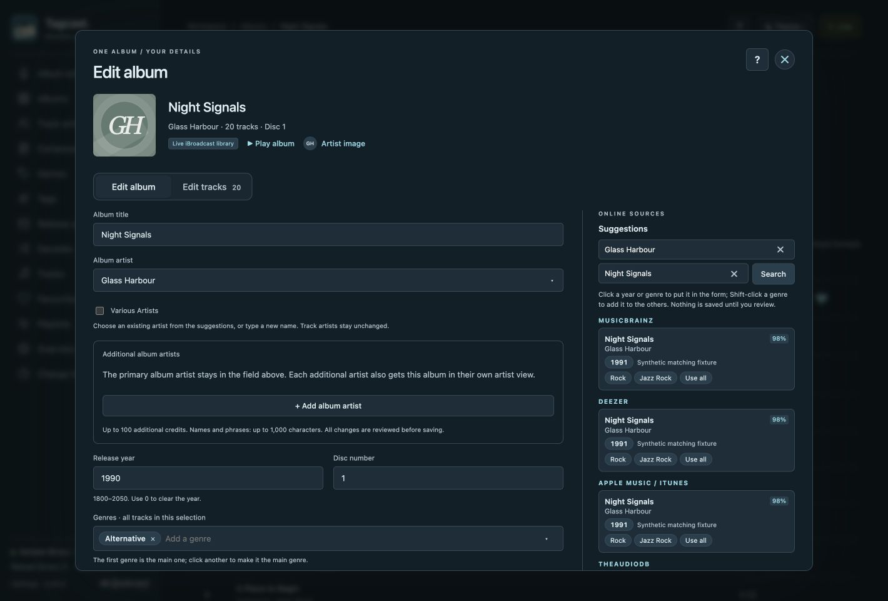

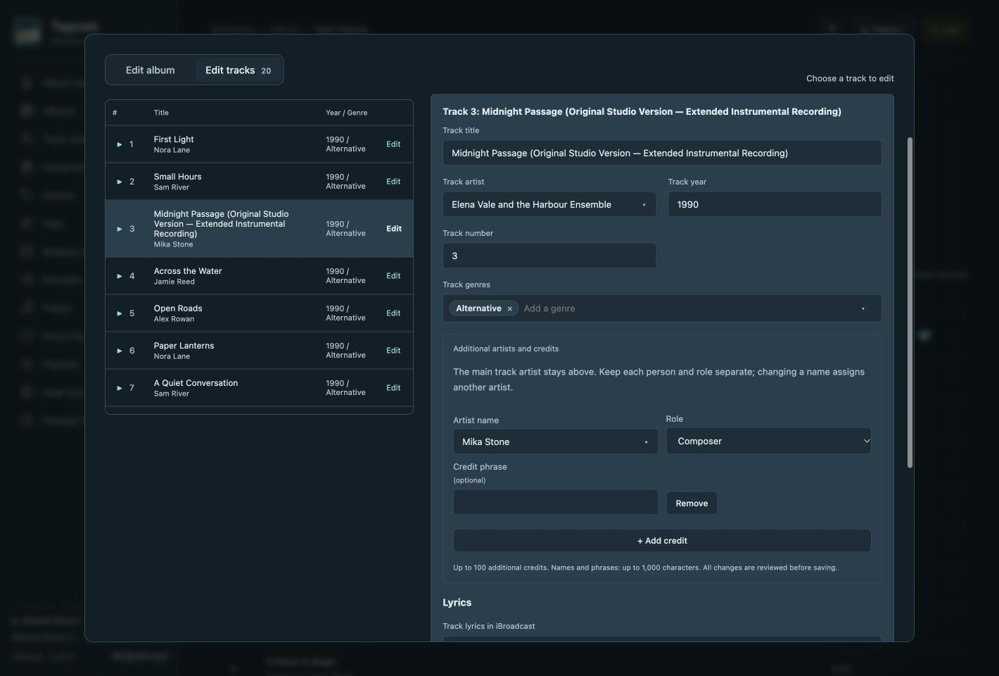

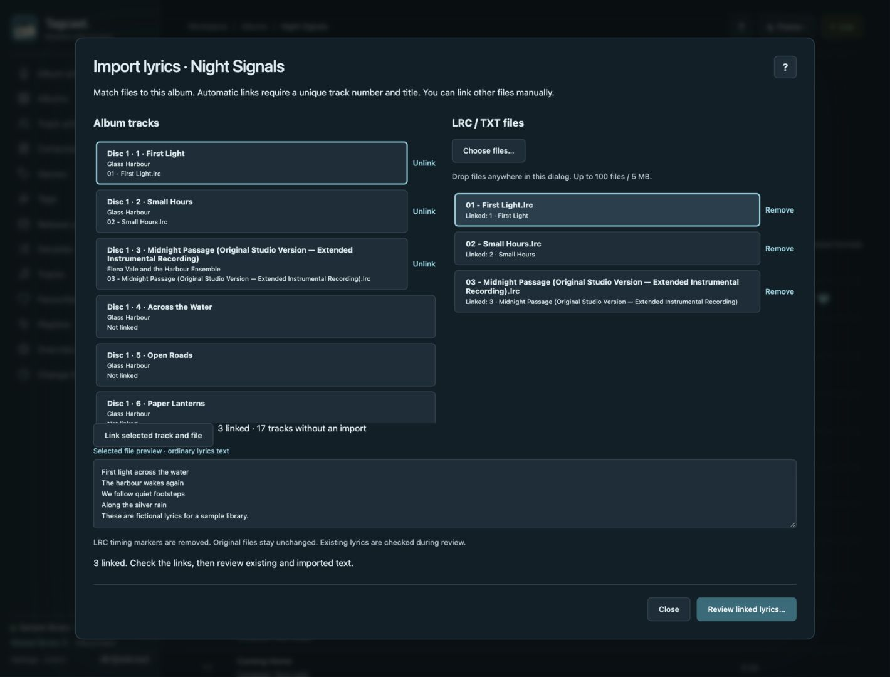

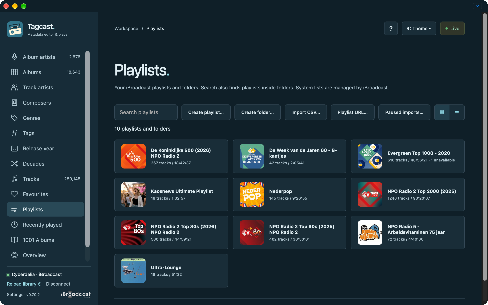

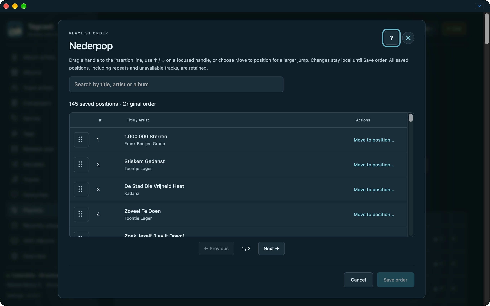

**Album artist cleanup:** reviewed semicolon splitting into a primary
artist and separate additional artists. This capture shows an approved run in progress.

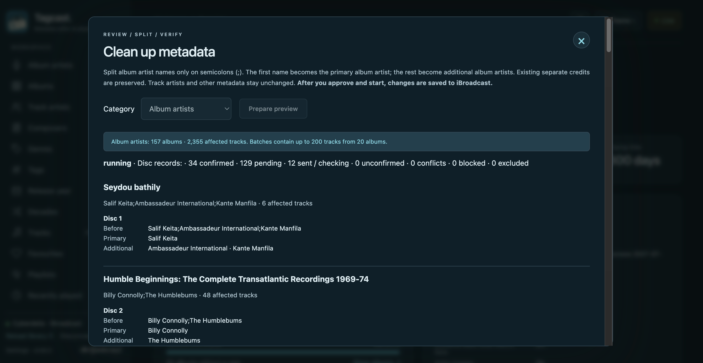

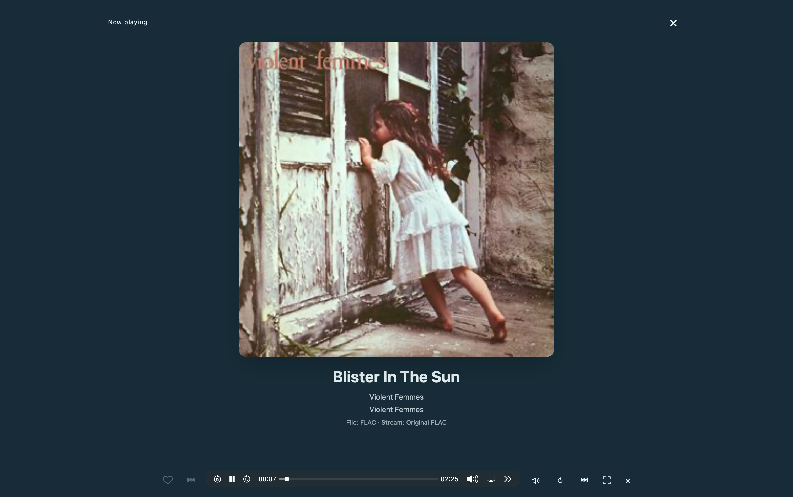

</details>

## Updating

**Quit the older Tagcast first**, or stop its terminal server with Ctrl+C. Replace
it with the new download, or update your source checkout. Your server settings
and local account favourites remain in place. Electron rejects an older server
on its port rather than loading the old interface.

For Homebrew: `brew update`, then `brew upgrade --cask cyberdeliaAI/apps/tagcast`.
Tagcast's update check only notifies; it never installs updates automatically.
[Update instructions](https://github.com/cyberdeliaAI/tagcast/wiki/Getting-started#updating-tagcast).

## Code signing policy

Tagcast has applied for Windows code signing through SignPath. Signing is
**not yet active**; approval and integration are pending.
Windows downloads remain unsigned. The macOS downloads are Developer
ID signed and notarized by Apple, independently of SignPath.

The planned signing service, subject to approval and integration, is:
Free code signing provided by [SignPath.io](https://signpath.io/), certificate by
[SignPath Foundation](https://signpath.org/).

- **Committers and reviewers:** [kaosnews](https://github.com/kaosnews).
- **Approvers:** [kaosnews](https://github.com/kaosnews).
- People with source-code or signing approval access are required to use MFA on
  GitHub and SignPath. This policy does not certify individual account settings.
- Once enabled, release signing requests must be manually approved by the
  designated approver. Only verified builds from this repository will be submitted;
  release notes will identify which downloads are signed.

See the [privacy policy](PRIVACY.md) for iBroadcast connections, optional source
lookups, automatic update checks and the public service-status feed, including
the available controls. macOS signing and notarization are separate from SignPath.

## Community

Join **[r/Tagcast on Reddit](https://www.reddit.com/r/Tagcast/)** to ask questions,
share ideas and discuss Tagcast with other listeners. For bug reports, use
[GitHub Issues](https://github.com/cyberdeliaAI/tagcast/issues).

## Development

A Python server and plain JavaScript frontend are shared by both routes.
[Development and API notes](https://github.com/cyberdeliaAI/tagcast/wiki/Development),
[Electron design](docs/electron.md) and [native builds](docs/native-builds.md)
describe the architecture, test commands and packaging. See
[documentation maintenance](docs/documentation.md) for Wiki updates.

## Media, credits and license

The [media kit](media/README.md) contains logos, icons, wordmarks, screenshots and
the GitHub social preview. [Download the media ZIP](https://github.com/cyberdeliaAI/tagcast/raw/refs/heads/main/media/tagcast-media-kit.zip).

Developed by Cyberdelia, with AI-assisted development using Claude (Anthropic)
and ChatGPT / Codex (OpenAI).

[MIT](LICENSE) for Tagcast code. The original Powered by iBroadcast logos belong
to iBroadcast and are displayed under its
[branding guidelines](https://help.ibroadcast.com/en/developer/branding).
