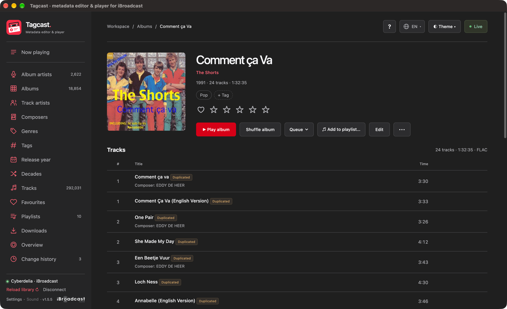
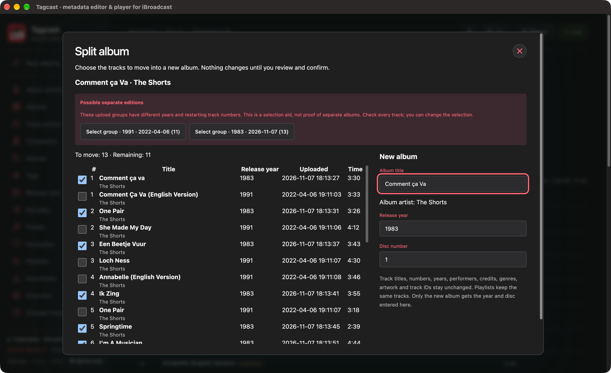
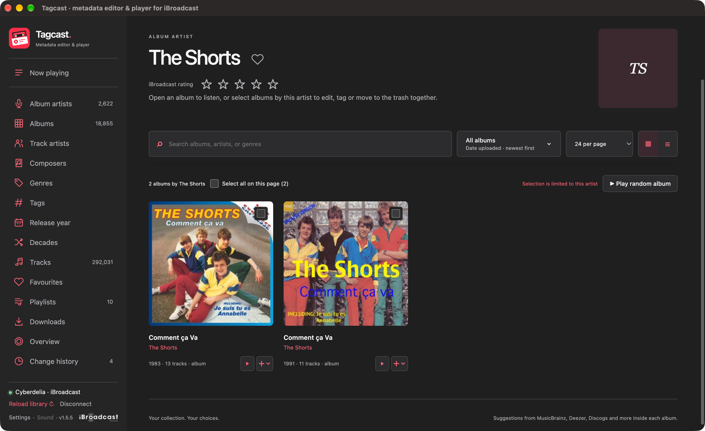

# Manual album splitting

Status: tested local implementation, prepared for GitHub review; not released.
The public 1.5.5 downloads do not include album splitting.

An iBroadcast album can contain tracks from different uploads or editions. A
different track year does not establish that a track belongs to a different
album. Tagcast therefore offers a manual selection and review, rather than
automatically splitting by year.

## Using the feature

1. Open an album and choose **More album actions → Split album…**.
2. Select the tracks to move. Leave at least one track in the original album.
3. Enter the new album's title, release year and disc number. Its primary album
   artist is copied from the original album.
4. Choose **Review split**, check the selected tracks and the number remaining,
   then explicitly confirm creation and movement in iBroadcast.
5. Wait for read-back before opening the new album. The existing queue and audio
   element continue independently.

For a displayed multi-disc set, select one native source disc at a time. The
feature currently supports 2–500 active tracks per source disc and requires
Combine Multi-Disc Album Sets to be off. Albums with additional album-artist
credits are blocked until those credits can be preserved reliably on creation.
The new primary album artist is not edited in this dialog.

Track IDs, titles, numbers, years, performers, additional credits, genres and
artwork are not changed. Playlists continue to reference the same track IDs.
The new album's cover follows its tracks. The original album's rating and local
favourite are not transferred to the new album. Local music files are untouched.

## Illustrated real-library example

The project owner tested the corrected Apple Silicon build with **Comment ça Va**
by **The Shorts** on 7 November 2026 and confirmed that splitting worked.
The local build still displays a 1.5.5 badge; this feature is not in that public release.

*Before: the 1983 and 1991 uploads appear together as one 24-track album. A
Duplicated badge indicates overlapping track positions; it does not prove that
the audio is identical.*

*Select the thirteen 1983 tracks, check the new album details and review before
confirming. The upload-group buttons are optional selection aids, not automatic fixes.*

*Result reported by the user: two album entries, with thirteen tracks for 1983 and
eleven for 1991. Matching artist and title do not force them back together.*

The [five-image inventory](screenshots/2026-11-07-album-split/README.md) preserves
all supplied captures, original filenames and checksums. The screenshots establish
this real-library example; they do not demonstrate every album or platform.

## Optional selection proposals

Proposals appear only inside the explicitly opened split dialog. They require
all of the following in the loaded metadata:

- Between two and ten distinct upload days, with at least two tracks per group.
- A single known release year within each group, different from every other group.
- Positive track numbers, without duplicate numbers within a group.
- Each group shares at least two track numbers with another group, indicating
  that numbering starts again across uploads.

Nothing is preselected. Choosing a proposal selects its tracks and fills the new
album year; the user can change both before review. Missing metadata, mixed years
within an upload group, or a year difference alone produce no proposal. These
are selection aids, not proof of separate releases or of the correct year.

An invented 24-track example reproduces the reported structure: eleven tracks
from one upload day, year 1991, numbered 1–11, and thirteen from another day,
year 1983, numbered 1–13. The dialog offers two groups. Selecting the second
moves thirteen tracks only after explicit confirmation and leaves eleven behind.

## Native API and failure handling

The payloads were checked against the public official web editor's
`createAlbum` and `moveTracksIntoAlbum` implementation in
[`iBroadcastLibraryEditor.js`](https://media.ibroadcast.com/js/iBroadcastLibraryEditor.js)
on 2026-11-07:

- `create_album`: `name`, `artist_id`, `year`, `disc`.
- `update_track`: a `tracks` array containing only `file_id`, destination
  `album_id`, and destination `album` name for the reviewed tracks.

These are two separate, non-transactional operations. Tagcast consumes a
session/account-bound review, checks the original membership and metadata, then
creates the album once. A successful reply must identify a new album ID. A fresh
library read must confirm the unchanged source before any tracks are moved.
The live service omits newly created empty albums from the library response, as
observed during the user's first test. The official web editor likewise retains
the creation receipt locally. Tagcast accepts only the confirmed new ID, absent
from both the previous album table and all previous track references. It checks
that no fresh track (including trashed/orphaned records) references it. If the
album is returned, its reviewed metadata and empty stored membership must match.
It never injects a synthetic album into the library or persistent cache.
Membership movement is sent once, without retries.

Final read-back checks both albums, exact active membership and the known track
metadata. An accepted move with a lost reply can be confirmed by read-back.
An unconfirmed operation is never automatically resent. An empty album or a
partial move may remain after a failure; reload and check iBroadcast before
starting a new review. There is no automatic rollback or metadata Undo.

The checks require full iBroadcast library reads, so large libraries can take
time. This feature does not change the library cache or existing save engine.
Selections/reviews are bounded and expire after fifteen minutes. They are not
restored after restart. Change history records results without offering a retry.

## Verification scope

Automated tests cover proposals, manual overrides, stale membership, invalid
targets, account/session replacement, single-use reviews, ambiguous replies,
partial moves, preservation checks, and real local HTTP request/read-back
integration against the existing mock iBroadcast server. Browser checks use
invented albums only. Automated development checks do not mutate a real account.
The project owner's separate live acceptance test of the corrected build succeeded;
see the illustrated example above.

Local validation on macOS Apple Silicon, 2026-11-07:

- Full Python suite: 900 tests and 2,479 subtests passed.
- Full frontend suite: 645 tests passed, including existing playback/queue tests.
- Electron shell suite: 47 tests passed using the project's Python environment.
- i18n suite: 26 tests passed; all six catalogues include the new controls.
- Ruff, JavaScript syntax (74 files), generated CSS/i18n and unchanged 1.5.5
  version consistency checks passed.
- Browser: English/Dutch, Light/Dark, 1280 × 800 and 420 × 800. Escape cancels;
  the mock split confirmed thirteen moved tracks and eleven remaining tracks.

The first isolated Apple Silicon package was tested locally with temporary
settings, restart and packaged-asset checks. The user's live test exposed the
empty-album omission: creation succeeded but the guard stopped before sending
any tracks. History confirmed three attempts with `not_sent` track results;
the retained library still contained all 24 source tracks. No retry, deletion or
other live-account write was performed during diagnosis. The dialog now displays
the specific server failure instead of masking it with a generic warning.

Regression coverage reproduces the omission, rejects orphaned/reused destination
IDs and any fresh track references, and keeps ignored/failed moves unconfirmed.
The local HTTP integration test also omits empty albums. The project owner then
confirmed the corrected move in a fresh, explicit live review. No other operating
system has yet been tested locally for this feature; remote CI results are recorded
on the pull request.

Correction validation, 2026-11-07:

- The omitted-empty-album regression failed with the original guard, before the
  correction; it now passes. Four focused Python regressions cover the omission,
  orphaned/reused IDs, fresh active/trashed references, and ignored/failed moves.
- Full Python suite: 904 tests and 2,483 subtests passed.
- Full frontend suite: 646 tests passed. The new failure-message regression checks
  escaping, terminal state, History preservation and absence of a retry.
- Electron: 47 tests passed; i18n: 26 tests passed. Ruff, JavaScript syntax,
  generated i18n and 1.5.5 version consistency passed.
- The normal packaged Apple Silicon application passed the existing Electron,
  bundled CLI, sandbox and owned-server shutdown checks.
- A separately named, locally packaged **Tagcast Album Split Test** was archived,
  extracted and its signature verified. The extracted app was started against
  the loopback mock service, using temporary settings and an invented 24-track
  fixture. Empty destinations were omitted from library responses. Review made
  no writes; confirmation made exactly one creation and one move, confirmed 13
  moved tracks / 11 remaining, and preserved all track metadata and playlists.
  Restart preserved mock login, settings and album membership without resending.
  All six served language bundles matched source; the app stopped its own server.

The corrected test archive is `build/album-split-fix/tagcast-album-split-fixed-macos-arm64.zip`.
It uses the earlier isolated test profile, not the production Tagcast profile.
Quit the earlier test app completely before opening the corrected copy, because
the unchanged 1.5.5 version alone cannot distinguish a running older test backend.
This is a local ad-hoc-signed test package, not a notarized public release. No
installed application was replaced and no live split was repeated.
