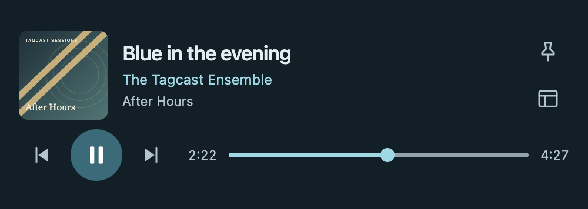

# Electron desktop and Python/browser use

Since 0.60.0, standalone downloads for macOS (Apple Silicon and Intel), Windows x64
and Linux x64 use Electron. Tagcast 1.0 pins Electron 44.9.3; source installs and the existing Python startscripts
continue to open the browser. Earlier releases retain their original browser launcher.

The 44.9.3 patch includes the certificate-blocking mitigation described in
[Electron's official security advisory GHSA-jr5w-w6x2-84p9](https://github.com/electron/electron/security/advisories/GHSA-jr5w-w6x2-84p9).
Only the Electron runtime and its matching lock entry were upgraded; the major
version, builder, fuses and application sandbox settings are unchanged.

## One application, two ways to open it

Both routes use the same `src/tagcast/` server and `static/` interface. There is no
second editor, player, library model or implementation of iBroadcast writes.
`electron/` adds window/menu handling, navigation restrictions and child-process
ownership. It bundles the Python server, so end users need neither Python nor Node.js.

The desktop window has standard Edit, View and Window menus, zoom, fullscreen and
Quit. Existing Media Session controls, output selection, volume and streaming stay
in the shared player. AirPlay/Sonos support and audio quality are not implied by
Electron; available devices/codecs still depend on Chromium and the operating system.

In Tagcast 0.80.0, **Settings → Interface → Now playing view**
offers **Fullscreen** (the existing default) and **In app window**. The choice is
remembered in this desktop/browser profile and applies on the next opening. The
same audio and queue remain in place. This does not change View → Toggle Full Screen
for the application window. **Help** also offers **Tagcast on Reddit** and
**Tagcast on GitHub**, alongside the existing Wiki link, using the same guarded
external browser opener. These additions first ship in 0.80.0.

## Settings in 0.85.0

Settings is a routed page; **Playback** contains Now playing view, compact-player preferences and optional [experimental Gapless playback](gapless-playback.md). Appearance also imports/exports individual custom themes as bounded JSON files. Imports are new unsaved previews; existing themes and the active Light/Dark/Auto preference stay unchanged until explicitly saved/applied. Files contain only a name, built-in base palette and colour overrides.

The existing normal app identifier/profile, backend folder and stable port remain unchanged. The private Gapless Test app's temporary port and write restrictions are not used by the release. The earlier 0.80.0 download has the dialog described above.

<a id="mini-player-development"></a>

## Mini Player

Included in the standalone downloads since **1.0.0**.
In the desktop app, choose **View → Open Mini Player**, press **Cmd/Ctrl+Shift+M**,
or choose **Mini Player** in the expanded Now playing view.

The compact window shows artwork, track information, Previous / Play-Pause / Next
and a track-relative seek bar in one row below the metadata. It opens at 500 × 210
logical window pixels and can be resized down to 420 × 210. Larger saved window
sizes are retained. Pin keeps it above other windows where the desktop supports it;
this option is unavailable on Linux/Wayland.

Only one Tagcast window is visible at a time. Opening Mini Player hides the main
window. **Open Tagcast**, closing Mini Player, or returning to the main window
restores the full interface and closes Mini Player. Playback continues through the
same audio element in the main renderer, including supported experimental Gapless
playback. Mini Player has no audio element, streaming/API access or separate queue.
Normal Quit and existing unsaved-change warnings still apply.

Window size, position and Pin are remembered in the desktop profile. Mini Player
does not start automatically or resume playback on launch. All four palettes and
Light/Dark follow the main interface. Python/browser use keeps its existing player.



*Mini Player interface, captured on 26 October 2026. Fictional track information and test artwork.*

## Settings, sign-in and closing

- Credentials, library cache, settings and local album favourites stay in the same
  `~/.tagcast/` folder, or the explicit `TAGCAST_HOME`. Nothing is copied into JavaScript.
- Electron has its own Chromium profile. Browser-local preferences, History/Undo
  and in-memory queues are separate from Safari/Chrome/Brave. They are not migrated
  automatically. The optional existing queue-sync feature remains available.
- The server binds to `127.0.0.1:8912`, or `TAGCAST_PORT`. A matching server already
  running on that port is reused and is left running on Quit. A different program,
  old version or incompatible host protocol is rejected; close it and retry.
- Closing the last window quits the desktop app. Only its owned server is stopped.
  Reviewed requests/read-backs finish; running cleanup batches stop between batches.
  There is no automatic forced kill or automatic resumption of writes.
- Existing unsaved-change/save warnings remain in force. **Sign in with iBroadcast**
  opens the official approval page in a separate native window. Approval returns to
  Tagcast automatically; closing the sign-in window cancels that pending attempt.
  **Use a code instead** retains a system-browser link if the window fails or a
  provider login requires another website. No password or token enters the Tagcast UI.
  The existing server-side device flow and requested scopes are unchanged. Provider
  cookies are separate from the main app and from your system browser.
- The main window and sign-in window remember their normal width and height in the
  desktop profile. Maximized/fullscreen dimensions do not replace the normal size.
  Restored sizes are clamped to the current display; position is not persisted here.
  Mini Player keeps its existing separate size, position and Pin preferences.
- Other external HTTPS links open in the system browser; web pages do not replace
  the application window.
  For an existing custom OAuth browser-redirect registration, return to Electron and
  use View > Reload after the browser confirms sign-in. Device-code sign-in updates
  the window normally and is the default.

## Run from source

Install the normal Python development environment first (`uv sync --frozen`), and
Node.js 24 LTS with npm. From the repository:

```sh
cd electron
npm ci
node node_modules/electron/install.js
npm start
```

The source launcher uses the repository's `.venv` Python, or an explicit
`TAGCAST_PYTHON`. It never installs a Python environment or changes dependencies
automatically. `TAGCAST_ELECTRON_PROFILE` can point at a separate Chromium profile
for development; use a separate `TAGCAST_HOME` for mock-account tests.

Python/browser use is unchanged: `start-tagcast.command`, `start-tagcast.sh`,
`start-tagcast.bat`, or `uv run tagcast --open`. Node.js is not required for this route.

## Build standalone downloads

Build on the target OS/architecture with Python 3.13, Node.js 24 LTS and npm:

```sh
uv run --frozen --with-requirements requirements-build.txt python tools/build_electron.py
```

Use `--dir` for an unpacked local test app and `--skip-install` only after `npm ci`.
The build freezes `tagcast.electron_host` and the browser CLI without Tk, packages them in Electron and
checks the actual app with disposable settings/profile folders. Complete downloads
are extracted and checked before their SHA-256 files are written to `dist/packages/`.
The macOS result is `Tagcast.app`, Windows has `Tagcast.exe`, Linux has `Tagcast`.
The separate `tagcast-cli` executable in `resources/backend/` (macOS:
`Tagcast.app/Contents/Resources/backend/`) retains normal browser/terminal use.
Keep the complete extracted package together.

Ordinary builds use ad-hoc macOS integrity signatures, not Developer ID notarization,
and no Windows Authenticode certificate. The explicit `--sign-macos` build route
requires Developer ID credentials and Apple notarization, with final ZIP verification;
see [Code signing](code-signing.md). Existing release archives are not changed by
adding this route. Platform opening requirements still apply to unsigned downloads.
The Electron MIT and Chromium notices remain in the app alongside the Python/runtime
licenses. All package/server/page/lockfile versions must match.

The Builds workflow checks all four targets. Ordinary pushes produce CI artifacts;
only the existing explicit release workflow attaches downloads to a release.
No Electron auto-updater is enabled. Tagcast's existing release check only notifies.

## Security and regression checks

The renderers are sandboxed and isolated, with no Node.js or generic IPC.
The desktop Mini Player uses narrow, validated preload bridges for presentation
snapshots and existing transport commands only. Sign-in adds a separate, fixed
bridge accepting only the pending server-issued request ID, never a renderer URL.
Its remote window has its own session, no preload/Node/IPC, and no device permissions
or downloads. Navigation stays on the official OAuth origin; other login routes
offer the system-browser fallback without cancelling the pending code.
It can navigate only to the shared application's entry pages. External links are
parsed as HTTPS URLs; native/file/JavaScript protocols and new app windows are denied.
Permissions are restricted to the main application frame's fullscreen, audio output
and sanitized clipboard writes; camera, microphone and screen capture are denied.
The existing early theme scripts are hashed in the desktop CSP. API Host/header/Fetch
Metadata guards remain shared with the browser version.

```sh
uv run --frozen pytest -q
node --test tests/frontend.test.cjs
node --test electron/tests/*.test.cjs
python tools/release_info.py
```

The shell tests cover protocol/address validation, forbidden navigation/permissions,
CSP, real child startup/shutdown and a missing interpreter. Extracted downloads also
check the bundled CLI's help and version. Python tests cover owned
and reused servers, foreign/old servers, parent EOF, HTTP guards and graceful writes.
Manual playback/output/fullscreen checks are still needed on each platform; an app
loading successfully does not establish support for every audio device.

An opt-in native sign-in check uses a temporary profile and loopback mock provider:

```sh
uv run --frozen python tools/check_sign_in.py --report /tmp/tagcast-sign-in.json
```

It checks approval/denial/cancellation, return to the existing audio element,
responsive layouts and both window sizes across restart. `--app` selects a packaged
executable. `--live-page` only opens the public iBroadcast login form and cancels it;
it never enters credentials or approves a real account. Reports contain no tokens,
provider URLs or personal account details. Real account approval and third-party
login still need a user check on supported platforms.
