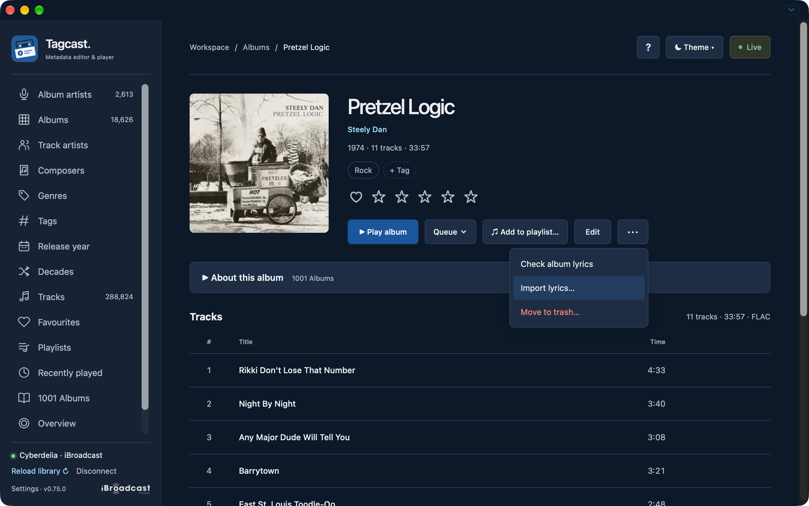
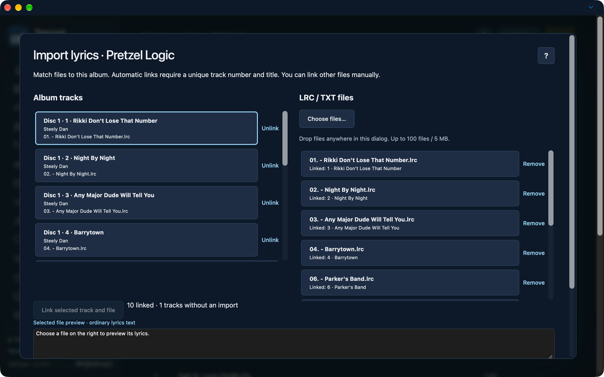
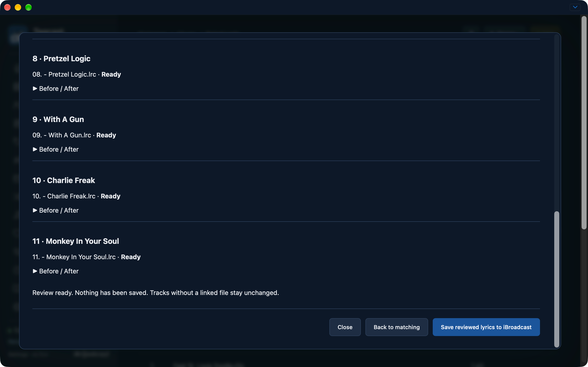
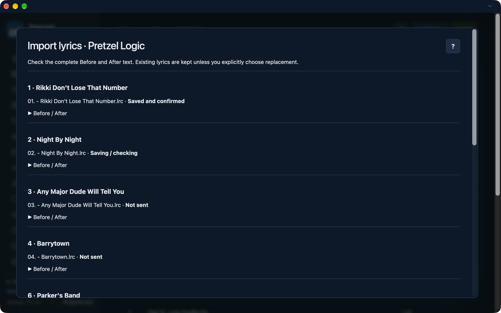

# Album lyrics file import

Unreleased development feature, separate from the published 0.75.0 downloads.

Open an album and choose **More album actions (⋯) → Import lyrics…**. The left
column shows the complete album's tracks. On the right, choose or drop `.lrc`
and `.txt` sidecars. This imports lyrics text, not music files.

## Matching files

A unique combination of track number and title links a file automatically.
`01 - Black Cow.lrc` matches track 1, Black Cow. Case, spacing, underscores and
usual dash/dot separators are normalized; version text is retained. Explicit
`CD2 - 01 - Title.lrc` or `2-01 - Title.lrc` prefixes also identify the disc.
Duplicate candidates and repeated positions across discs are not guessed.

Select a track on the left and a file on the right, then choose **Link selected
track and file** to adjust a link. Each file can link to one track. **Unlink**
excludes a track; **Remove** removes a file from the local import. Selecting a
file previews its text. Playback and the current queue stay unchanged.

Choose up to 100 files, at most 5 MB together / 500 KB per file. UTF-8 and
BOM-marked UTF-16 are supported. Text must be nonempty and at most 50,000
characters. Timing and common metadata markers are removed from LRC text;
Tagcast stores and displays ordinary lyrics, not synchronized playback.

## Review and save

**Review linked lyrics…** reads fresh native lyrics for linked tracks only.
Compare **Before / After** for every linked track. Existing lyrics are kept by
default; choose **Replace existing lyrics for this track** individually to
replace them. Identical text is unchanged. Unlinked tracks are never written.

**Save reviewed lyrics to iBroadcast** requires Premium. It runs individual
single-use lyrics reviews and writes sequentially, checking exact album
membership, matching identities and the full native userdata before each write.
Unknown custom userdata is preserved. Every accepted write is read back.

**Stop after current request** finishes that request and its confirmation, then
leaves remaining changes unsent. Conflicts, request failures or unconfirmed
results stop subsequent writes. Results distinguish saved/confirmed, kept,
unchanged, blocked/not sent and unconfirmed changes. An uncertain request is
never automatically retried. Back to matching requires fresh reads and another
review before a new save.

Files and links remain in browser memory only. Closing an unsaved import asks
before discarding it. Navigation, account/library replacement or source changes
invalidate the draft and stop further requests. There are no LRCLIB requests,
audio reads, local music-file edits, or metadata-history/Undo entries.

## Screenshots

These original test captures show the unreleased feature; the 0.75.0 badge does
not indicate availability in the published desktop downloads.

**Open Import lyrics from the album More menu.**

**Album tracks on the left and LRC/TXT files on the right, with ten links and one track without an import.**

**Review ready before saving, with Before / After disclosures and the explicit Save reviewed lyrics button.**

**Save in progress: the first track is confirmed, the second is being checked and later tracks have not been sent.**

[Original-file inventory and SHA-256 manifest](screenshots/2026-10-22-lyrics-import/README.md).
